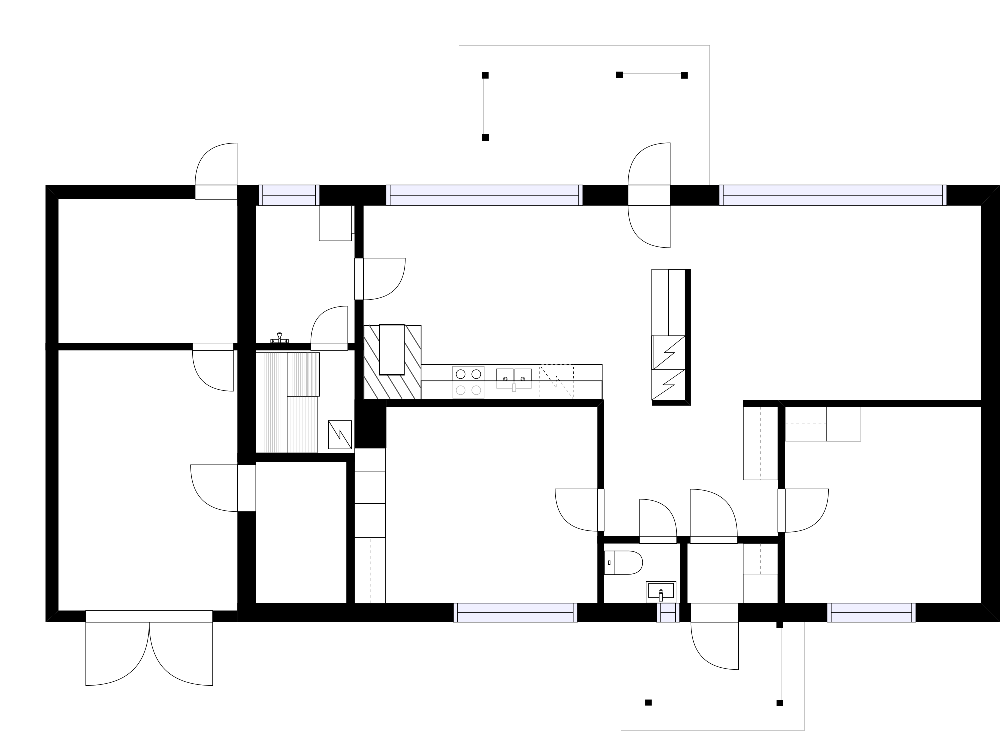
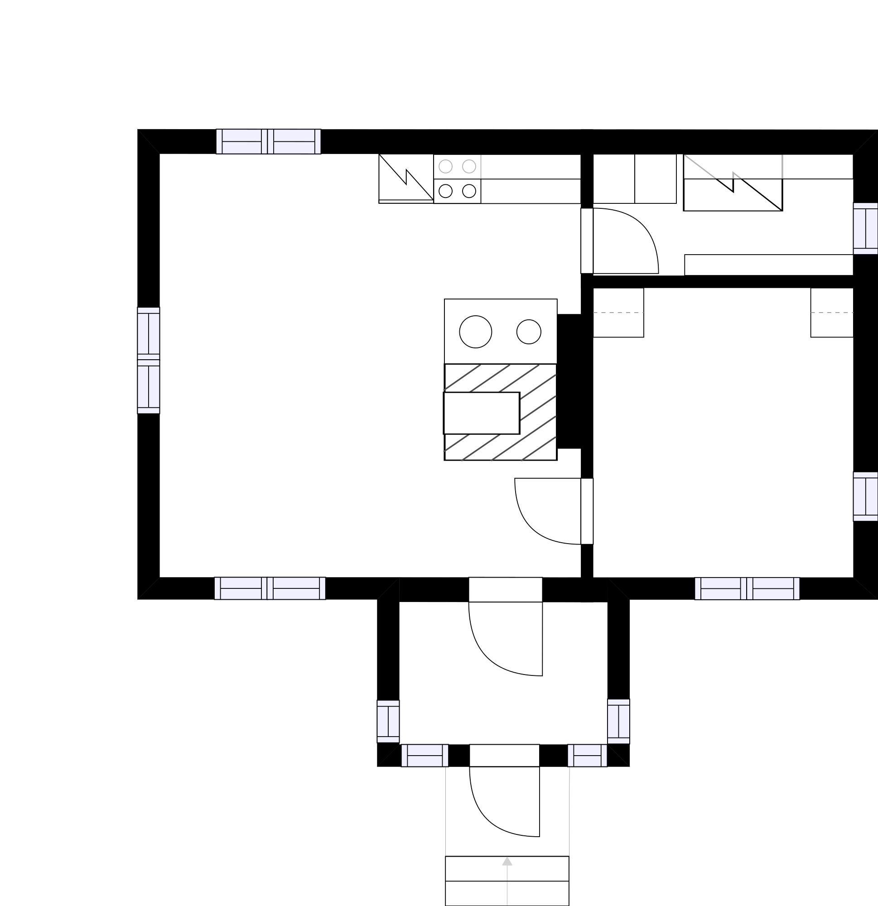
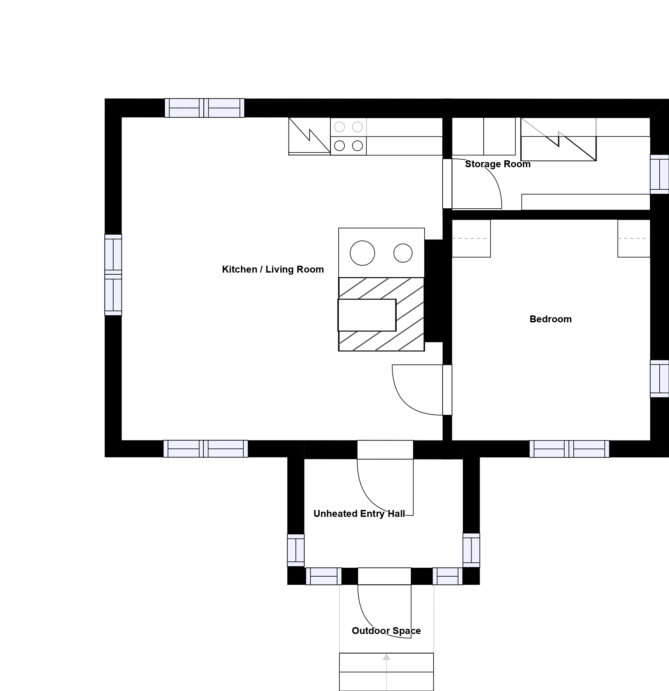

# CINF 499 — Security Engine

**Stetson University | Senior Research Project**

## Project Overview

This project explores the use of artificial intelligence
to analyze architectural floor plans and support physical
access control system planning.

The primary objective is to develop a machine learning
pipeline capable of taking a blank architectural floor
plan and placing readable English room labels while
preserving the original architectural layout.

The project consists of a floor plan analysis pipeline,
previous Pix2Pix research, and a physical access control
management application.

## Floor Plan Dataset

The project utilizes 2,000 architectural floor plans
from the CubiCasa5k dataset.

Dataset preparation included:

- Analysis of original SVG annotations
- Finnish-to-English room label translation
- Removal of existing floor plan labels
- Generation of paired floor plan images
- Automated room mask generation
- Dataset validation
- Training, validation, and testing splits

### Dataset Distribution

| Dataset | Floor Plans |
|---|---:|
| Training | 1,600 |
| Validation | 200 |
| Testing | 200 |
| Total | 2,000 |

## Pix2Pix Research

The initial approach utilized Pix2Pix image-to-image
translation to generate English room labels directly
from blank architectural floor plans.

Multiple experiments were conducted using different
dataset preparation methods, image resolutions,
training configurations, and loss functions.

Although the model produced recognizable floor plan
structures, the generated room labels were not
consistently readable.

This limitation led to a transition from direct
image-to-image translation to semantic segmentation
and programmatic label placement.

The original Pix2Pix experiments remain in the
repository for research documentation and comparison.

## Semantic Segmentation

The current approach utilizes a U-Net semantic
segmentation model to identify room classes within
architectural floor plans.

The pipeline separates room classification from
text generation, allowing English room labels to
be rendered directly onto the original floor plan.

### Model Pipeline

1. Input a blank architectural floor plan.
2. Preprocess the image for model inference.
3. Predict room classes using the trained U-Net model.
4. Apply post-processing to the predicted room mask.
5. Determine room label placement.
6. Render English labels onto the original floor plan.
7. Export the labeled floor plan.

The original floor plan is retained as the base image
rather than being regenerated by the model.

### Model Configuration

| Configuration | Value |
|---|---|
| Architecture | U-Net |
| Framework | PyTorch |
| Input Resolution | 512 x 512 |
| Output Classes | 21, including background |
| Trainable Parameters | 1,944,389 |
| Training Epochs | 20 |
| Best Validation Epoch | 14 |
| Best Validation Foreground mIoU | 21.28% |

The trained model checkpoint and prediction pipeline
are included in the repository.

See [Segmentation Documentation](segmentation/README.md).

## English Room Label Generation

The original SVG annotations were used to generate
English-labeled reference floor plans.

The reference generation process utilizes room
geometry, a Finnish-to-English translation dictionary,
and programmatic label placement.

### Reference Generation Results

| Metric | Result |
|---|---:|
| Floor Plans Processed | 2,000 |
| Floor Plans Generated | 2,000 |
| Translation Dictionary Entries | 257 |
| Translated Room Entries | 17,549 |
| English Labels Placed | 16,939 |
| Translated Labels Skipped | 610 |
| Undefined or Untranslated Entries | 3,907 |
| Reference Label Placement Rate | 96.52% |
| Processing Errors | 0 |
| Image Dimension Mismatches | 0 |

The reference label placement rate measures the
successful placement of translated labels using
existing room annotations. It does not represent
the independent prediction accuracy of the U-Net model.

### Example Floor Plans

| Blank Floor Plan | English-Labeled Reference |
|---|---|
|  |  |
|  |  |

These examples demonstrate annotation-based English
label generation and are not independent AI predictions.

## Access Control Management Application

A Java Spring Boot application developed for managing
a simulated physical access control system.

Application functionality includes:

- User authentication and role-based access control
- Door management
- User administration
- Access event tracking
- Floor plan upload
- Server-side input validation
- Secure file storage

Technologies include Java, Spring Boot, Spring Security,
Thymeleaf, Bootstrap, Maven, and MongoDB.

See [Frontend Documentation](frontend/README.md).

The access control application and machine learning
pipeline currently operate as separate components.

## Repository Structure

    cinf499-security-engine/
    |-- frontend/
    |-- pix2pix/
    |   |-- preprocessing/
    |   |-- evaluation/
    |-- segmentation/
    |   |-- checkpoints/
    |   |-- datasets/
    |   |-- examples/
    |   |-- experiments/
    |   |-- results/
    |   |-- model.py
    |   |-- predict.py
    |   |-- render_labels.py
    |   |-- train.py
    |   |-- train_full.py
    |-- dataset/
    |   |-- final_translations.json
    |   |-- reports/
    |-- README.md
    |-- .gitignore

## Current Status

The semantic segmentation model has been trained,
and the prediction pipeline can accept blank floor
plan images and generate readable English room labels.

The reference generation pipeline has successfully
processed all 2,000 floor plans.

Current limitations include room classification
accuracy, incorrect or duplicate predicted labels,
and label placement within smaller rooms.

Independent held-out test evaluation and integration
with the access control management application
remain areas for further development.

The complete generated datasets and large Pix2Pix
checkpoints are stored locally. Selected examples,
training results, source code, and the trained U-Net
checkpoint are included in this repository.

## Technologies

### Machine Learning

- Python
- PyTorch
- Pix2Pix
- U-Net
- NumPy
- Pillow
- SciPy
- CairoSVG

### Application Development

- Java 21
- Spring Boot
- Spring Security
- Thymeleaf
- MongoDB
- Bootstrap
- Maven

## Academic Information

**Course:** CINF 499 — Senior Research

**Institution:** Stetson University

**Research Focus:** Artificial Intelligence and Physical
Access Control Systems

## References and Acknowledgments

- CubiCasa5k architectural floor plan dataset
- PyTorch CycleGAN and Pix2Pix implementation
- U-Net semantic segmentation architecture

Original Pix2Pix implementation:
https://github.com/junyanz/pytorch-CycleGAN-and-pix2pix

Original third-party documentation, citations, and
licensing information are preserved in the repository.
